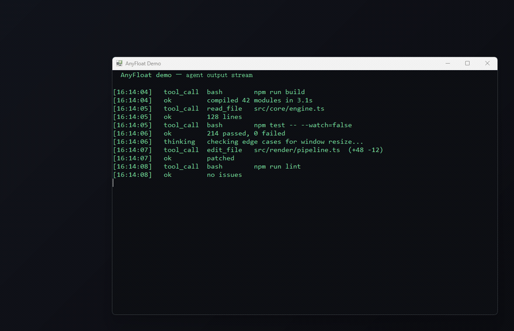

# AnyFloat


**English** | [简体中文](README.zh-CN.md)

> Turn any window into a live, read-only picture-in-picture thumbnail — click to restore.

When you're running an agent, a build, or a long task, you want to keep an eye on it — but you don't want that window hogging your screen, and you certainly don't want to click into it by accident. AnyFloat shrinks any window into a semi-transparent thumbnail pinned to the corner of your screen: **the content keeps updating, mouse and keyboard can't reach it, and one click restores it.**



---

## Features

- **Any window** — browsers, terminals, VS Code, Electron apps, media players
- **True live thumbnail** — the whole window is scaled down proportionally; the app never reflows its layout. Text gets blurry, but you can still see what it's doing
- **Read-only** — the source window is made invisible in place and frozen; mouse, keyboard and Alt+Tab can't reach it
- **Semi-transparent with a soft glow** — you can faintly see what's underneath
- **Hover to enlarge** — rest the cursor for 90 ms and it expands to a readable size; move away and it collapses
- **Click to restore** — animates back to its original position, restores the window's styles and activates it
- **Multiple windows** — up to 6 at once, stacked along the screen edge, the rest re-pack when one is closed
- **Multi-monitor aware** — each thumbnail sits on the monitor its source window lives on, and is sized for that monitor's DPI
- **Crash recovery** — if the process is killed, the next launch automatically restores any window left in the "transparent + disabled" state

## Quick start

**Option A — installer (recommended)**

1. Download `anyfloat-v0.2.0.zip` from [Releases](https://github.com/Teassassin/anyfloat/releases) and extract it
2. Right-click **`Install-AnyFloat.ps1`** → *Run with PowerShell*

It copies the program to `%LOCALAPPDATA%\AnyFloat`, asks whether to start it on login (no admin rights needed), and launches it. Then switch to the window you want to watch and press **`Win+Shift+F`**.

**Option B — run from the source folder**

```powershell
git clone https://github.com/Teassassin/anyfloat.git
cd anyfloat
```

Double-click **`Start-AnyFloat.vbs`** (starts without a console window — a tray icon means it's running).

> Requirements: Windows 10 / 11. No dependencies — PowerShell 5.1 is built in.

## Hotkeys

| Action | Effect |
|---|---|
| `Win+Shift+F` | Float the foreground window as a live thumbnail; press again to restore |
| `Win+Shift+G` | Restore all floating windows |
| Hover 90 ms | Expand to a readable size |
| Move away | Collapse back to the pill |
| **Click the thumbnail** | Restore that window and bring it to the foreground |
| Double-click while expanded | Also restores |
| Tray menu | Toggle / Restore all / Quit |

> If a hotkey is taken, AnyFloat falls back automatically: `Win+Shift+F` → `Ctrl+Alt+F` → `Win+Alt+A`. The tray tooltip shows which one is active.

## Configuration

Edit the parameters at the top of `AnyFloat.ps1` and restart the script:

| Parameter | Default | Description |
|---|---|---|
| `$PillWidth` | 420 | Pill width in px (height follows the source window's aspect ratio) |
| `$PillHeightMax` | 320 | Maximum pill height |
| `$Margin` | 18 | Gap from the screen edge |
| `$SlotGap` | 10 | Gap between stacked pills |
| `$MaxFloats` | 6 | Maximum number of floating windows |
| `$DwellMs` | 90 | Hover dwell before expanding (lower = snappier, higher = fewer accidents) |
| `$AnimMs` | 190 | Base animation duration in ms |
| `$ExpandWidth` / `$ExpandHeight` | 1100 / 780 | Maximum expanded size |
| `$CaptureFps` | 12 | Capture rate while collapsed |
| `$ExpandFps` | 20 | Capture rate while expanded |
| `$GlowPad` | 12 | Soft glow thickness (0 disables) |
| `$ContentAlpha` | 0.90 | Thumbnail opacity (1.0 = opaque) |
| `$ScaleWithDpi` | `$true` | Scale pill width / margin / glow by the monitor's effective DPI, so it looks the same physical size at 100% and 150% |

## How it works

1. **The source window goes invisible in place** — it gets `WS_EX_LAYERED` + `alpha=1` (invisible), `WS_EX_TRANSPARENT` (click-through) and `EnableWindow(FALSE)` (input frozen), and is removed from the taskbar and Alt+Tab. **Crucially, it must stay at its original screen position** — moving it off-screen makes Chromium-based apps stop rendering entirely.
2. **Capture** — a background thread periodically grabs the window with `PrintWindow(PW_CLIENTONLY | PW_RENDERFULLCONTENT)`.
3. **Compose** — another thread scales the frame onto a persistent DIB section, adds rounded corners, transparency and the soft glow, then commits everything with a single `UpdateLayeredWindow` call (which also sets the window's position and size).
4. **Animate** — the animation thread only changes the "image rectangle"; the compositor redraws. Scaling is a pure bitmap operation — no window is ever resized.

### Why not the obvious approaches

| Approach | What happened |
|---|---|
| DWM thumbnails (`DwmRegisterThumbnail`) | The thumbnail **freezes** once the source window moves off-screen (identical capture hashes across three samples) |
| Move the window off-screen + `PrintWindow` | Chromium-based apps stop rendering when occluded, so captures become stale partial frames (missing content / half the window blank) |
| Animate with `SetWindowPos` | Triggers window reflow: jittery frame rate and clipped content |
| `DwmFlush` for vsync | Blocks for 100–260 ms in some environments (e.g. while a game stream is running) — the whole animation collapsed to 3 frames |
| `DrawImageUnscaled` for repaint | The frame size changes every animation step, so stale frames get clipped and the image visibly "jumps" |

## Known limitations

- **Exclusive-fullscreen games**: layered windows can't cover them
- **DRM-protected content**: `PrintWindow` returns black; the thumbnail shows "该窗口无法抓帧" (cannot capture this window)
- **Elevated windows**: a non-elevated process can't change their window styles (UIPI) — run AnyFloat as administrator for those
- **CPU**: capturing + scaling + compositing costs roughly 2–5% of one core per window at 12 fps; lower `$CaptureFps` if you float many
- While floating, the source window is invisible but still occupies its screen area (clicks pass through, so it doesn't block anything)

## Uninstall

If you used the installer, run:

```powershell
powershell -ExecutionPolicy Bypass -File "$env:LOCALAPPDATA\AnyFloat\Uninstall-AnyFloat.ps1"
```

It stops the tool, removes the startup entry and deletes the folder — and first runs the crash-recovery pass so no window is left invisible and frozen on your desktop.

If you ran it from the source folder, just right-click the tray icon → **Quit**, then delete the folder. AnyFloat writes no registry keys and leaves nothing behind (the debug log at `%TEMP%\anyfloat.log` only exists if you started with `-DebugLog`).

## Build from source

```powershell
powershell -ExecutionPolicy Bypass -File .\build.ps1
```

Produces `dist\anyfloat-v<version>.zip` plus its SHA256. The script refuses to build if a `.ps1` is missing its UTF-8 BOM, a `.vbs` has one (or contains non-ASCII), or anything from `AGENTS.md` / `dev/` sneaks into the package.

## Contributing

Issues and pull requests are welcome. Development and test scripts live in the [anyfloat-dev](https://github.com/Teassassin/anyfloat-dev) repository.

## License

MIT
