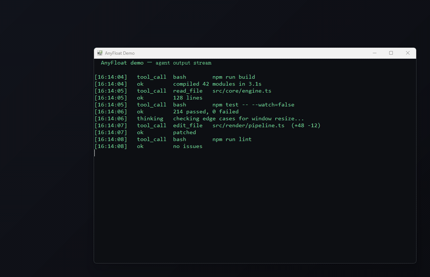

# AnyFloat

[English](README.md) | **简体中文**

> 把任意窗口变成**实时缩略图悬浮窗**——只读监看，点击复原。

跑 agent、构建、长任务的时候，你想一直盯着进度，但又不想让那个窗口占住屏幕，更不想手滑点到它。
AnyFloat 把任意窗口变成贴在屏幕边缘的半透明小窗：**内容实时更新，鼠标键盘都进不去，点一下就复原**。



---

## 特性

- **任意窗口**：浏览器、终端、VS Code、Electron 应用、播放器都行
- **真·实时缩略图**：整窗等比缩小，不是让应用重排布局；文字会糊，但整体动向一眼看清
- **只读**：源窗口原地隐形并被冻结，鼠标、键盘、Alt+Tab 全部进不去
- **半透明 + 虚化光晕**：能隐约看到底下的内容，不挡视线
- **悬停放大**：鼠标停 90ms 自动放大到可读尺寸，移开自动收回
- **点击复原**：动画展开回原位，恢复窗口样式并激活
- **多窗口**：最多同时悬浮 6 个，沿角落堆叠，关掉一个其余自动补位
- **崩溃自愈**：进程被强杀后，下次启动会自动把遗留在"透明+禁用"状态的窗口救回来

## 快速开始

```powershell
git clone https://github.com/Teassassin/anyfloat.git
cd anyfloat
```

双击 **`Start-AnyFloat.vbs`**（无黑窗启动，托盘出现图标即成功）。

然后切到你想盯的窗口，按 **`Win+Shift+F`**。

> 系统要求：Windows 10 / 11，无需安装任何依赖（PowerShell 5.1 已内置）。

## 快捷键

| 操作 | 效果 |
|---|---|
| `Win+Shift+F` | 当前前台窗口 → 变成悬浮缩略图；再按一次复原 |
| `Win+Shift+G` | 复原全部 |
| 悬停悬浮窗 90ms | 放大到可读尺寸 |
| 鼠标移开 | 收回胶囊 |
| **单击悬浮窗** | 复原该窗口并激活到前台 |
| 展开状态下双击 | 同样复原 |
| 托盘菜单 | 切换 / 复原全部 / 退出 |

> 热键被占用时会自动降级：`Win+Shift+F` → `Ctrl+Alt+F` → `Win+Alt+A`，托盘提示里会显示实际生效的组合。

## 配置

改 `AnyFloat.ps1` 顶部的参数，重启脚本生效：

| 参数 | 默认 | 说明 |
|---|---|---|
| `$PillWidth` | 420 | 胶囊宽度（高度按源窗口比例自动算） |
| `$PillHeightMax` | 320 | 胶囊高度上限 |
| `$Margin` | 18 | 距屏幕边缘留白 |
| `$SlotGap` | 10 | 多个悬浮窗之间的间距 |
| `$MaxFloats` | 6 | 最多同时悬浮几个 |
| `$DwellMs` | 90 | 悬停多久展开（调小更灵敏，调大更防误触） |
| `$AnimMs` | 190 | 动画时长基准（毫秒） |
| `$ExpandWidth` / `$ExpandHeight` | 1100 / 780 | 放大后的最大尺寸 |
| `$CaptureFps` | 12 | 胶囊状态抓帧率 |
| `$ExpandFps` | 20 | 放大状态抓帧率 |
| `$GlowPad` | 12 | 虚化边框厚度（0 = 关闭） |
| `$ContentAlpha` | 0.90 | 画面不透明度（1.0 = 不透明） |

## 工作原理

1. **源窗口原地隐形**：给它加上 `WS_EX_LAYERED` + `alpha=1`（看不见）、`WS_EX_TRANSPARENT`（点击穿透）、`EnableWindow(FALSE)`（冻结输入），并从任务栏 / Alt+Tab 移除。**关键点：窗口必须留在屏幕原位**——移到屏幕外会让 Chromium 系应用停止渲染。
2. **抓帧**：后台线程用 `PrintWindow(PW_CLIENTONLY | PW_RENDERFULLCONTENT)` 定时抓取源窗口画面。
3. **合成**：另一个线程把画面缩放绘制到常驻 DIB Section 上，加上圆角裁剪、半透明、虚化光晕，然后 `UpdateLayeredWindow` 一次性提交（同时设定窗口位置与尺寸）。
4. **动画**：动画线程只改"图像矩形"，由合成线程重绘——缩放是纯位图操作，不触发任何窗口重排。

### 为什么不用别的方案

| 方案 | 结果 |
|---|---|
| DWM 缩略图（`DwmRegisterThumbnail`） | 源窗口移出屏幕后画面**冻结**（实测三次抓帧哈希相同） |
| 把源窗口移出屏幕 + `PrintWindow` | Chromium 判定被遮挡后**停止渲染**，只能拿到过期残帧（表现为内容缺失/右半边空白） |
| 用 `SetWindowPos` 做缩放动画 | 触发窗口重排，帧率抖动、画面被裁切 |
| `DwmFlush` 对齐垂直同步 | 某些环境（如同时跑游戏串流）会阻塞 100–260ms，动画只剩 3 帧 |
| `DrawImageUnscaled` 重绘 | 动画中尺寸每帧在变，旧尺寸的帧被裁切，视觉上"跳" |

## 已知限制

- **独占全屏游戏**：分层窗口无法覆盖，不适用
- **DRM 保护内容**：`PrintWindow` 会返回黑图，悬浮窗显示"该窗口无法抓帧"
- **管理员权限窗口**：普通权限进程无法修改其窗口样式（UIPI），需要以管理员身份运行本工具
- **CPU**：抓帧 + 缩放 + 合成，单窗口约 2–5% CPU（12fps）；悬浮多了可以调低 `$CaptureFps`
- 悬浮期间源窗口虽不可见，但仍占着那块屏幕区域（点击会穿透，不影响操作下方窗口）

## 卸载

托盘图标右键 → **退出**，然后删除文件夹即可。本工具不写注册表、不留残留（调试日志在 `%TEMP%\anyfloat.log`，仅在 `-DebugLog` 时生成）。

## 贡献

问题反馈和 PR 都欢迎。开发和测试脚本在 [anyfloat-dev](https://github.com/Teassassin/anyfloat-dev) 仓库。

## 许可

MIT
